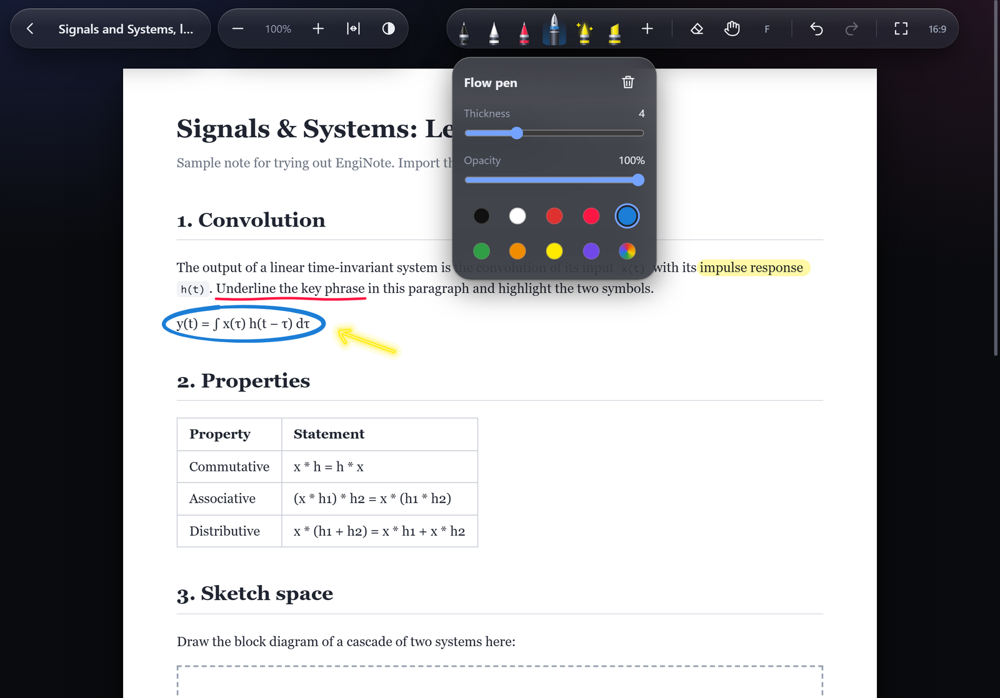

# EngiNote

Import your notes as HTML or PDF files, or start a blank notebook, and write over them, like GoodNotes or Freenotes, but for web pages too. It runs in any browser, and as an iPad app with Apple Pencil support and a built-in screen recorder.

**Try it:** [enginote.vercel.app](https://enginote.vercel.app) · **iPad app:** [latest build (.ipa)](https://github.com/ayushheheheha/EngiNote/releases/latest/download/EngiNote.ipa)



## What it does

**Notes**
- Import one or more `.html` or `.pdf` files (button, or drag and drop). Each becomes a note you can open and write on.
- **New notebook** makes blank paged paper: plain, ruled, grid or dotted, in your choice of size, direction, paper colour, line colour and spacing. A thin line marks each page, and pages are added as you write.
- **Add space**: a blank page between two pages of a notebook or PDF, or a gap between two parts of an HTML note. The ink below moves down with it.
- **Export** a note with its ink as a PDF (the iPad app makes the file; a browser opens its print dialog, which can save one).
- Search your notes, sort them by date or name, and duplicate one.
- Organise notes in folders. Rename anything by typing over its name.
- Notes are saved automatically, on your device.
- Back up every note and folder to one file, and restore from it. Restoring only adds; it never deletes or overwrites newer work.

**Writing**
- A tray of your own pens. Each pen has its own kind, colour, thickness and opacity, and you can add or remove pens (up to 12).
- Five kinds of pen: an even **pen**, a **flow pen** that swells and thins with pressure, a **glow pen**, a **highlighter**, and a **laser pointer** whose trail fades and is never saved.
- A **stability** setting on each pen, to steady a shaky line.
- Hold the tip still at the end of a stroke and it becomes a straight line, ellipse, rectangle or triangle.
- A **lasso**: circle some ink, then move it, resize it, recolour it or delete it.
- Strokes are smoothed as you draw, so they stay clean even when zoomed far in.
- An eraser with an adjustable size, and an option to switch back to your pen after each use.
- Undo and redo.

**Getting around**
- Fingers scroll and pinch to zoom; only the stylus (or mouse) draws, so a resting palm never leaves a mark. A toggle lets fingers draw instead.
- Pinch-zoom snaps to fit-width when you get close to it.
- Light and dark themes.
- Full screen, with the tools in a thin rail at the side.
- A small arrow hides the toolbar and brings it back.
- A 16:9 window, for presenting or recording.

**Only in the iPad app**
- Apple Pencil double-tap switches between the eraser and your last pen; squeeze undoes.
- Screen recording to a video file, with your voice, pause and resume, and three quality settings.
- "Enhance" removes background noise from your voice.
- A countdown before a recording starts, and a mic check that shows your voice as live sound waves.
- A camera bubble showing you over the note: drag it anywhere, pinch to resize it, double-tap to change its shape (circle, rounded square, wide, tall).
- A Recordings folder to play, share or delete your videos, and a simple editor (the scissors button on a recording) to trim, split and cut parts out, with undo and redo. The edited video is saved as a new recording; the original is kept.

## Using it

### In a browser

Open [enginote.vercel.app](https://enginote.vercel.app) and import an HTML file. To try it without one, save [`sample.html`](sample.html) and import that.

### On an iPad

EngiNote is not on the App Store. You install it with [AltStore](https://altstore.io), a free tool that signs apps with your own Apple ID. Allow about 15 minutes the first time.

**You need**

- An iPad on **iPadOS 17.5 or later** (Settings › General › About). An Apple Pencil is optional, but the Pencil features need one.
- A **Windows PC or Mac**, only for the install and for refreshing the app every 7 days.
- A free **Apple ID**.
- A USB cable, or the iPad and computer on the same Wi-Fi.

**1. Put AltStore on the iPad (once)**

1. On the computer, download **AltServer** from [altstore.io](https://altstore.io) and install it.
   - *Windows:* install **iTunes** and **iCloud** from apple.com, not from the Microsoft Store, or AltServer cannot find the iPad.
2. Connect the iPad to the computer with the cable and tap **Trust** on the iPad.
3. Open AltServer (Windows: its icon is in the system tray; Mac: the menu bar), choose **Install AltStore**, pick your iPad, and sign in with your Apple ID.
4. On the iPad, open **Settings › General › VPN & Device Management**, tap your Apple ID under *Developer App*, and tap **Trust**.
5. On the iPad, turn on **Settings › Privacy & Security › Developer Mode**, then restart when asked.

**2. Install EngiNote**

1. On the iPad, open [this link](https://github.com/ayushheheheha/EngiNote/releases/latest/download/EngiNote.ipa) in Safari to download `EngiNote.ipa`. It is saved in Files › Downloads.
2. Open **AltStore**, go to **My Apps**, tap **+** at the top left, and choose `EngiNote.ipa`.
3. Wait for it to install. EngiNote now appears on the Home Screen.

**3. Keep it working**

- A free Apple ID lets an app run for **7 days**, then AltStore must refresh it. Keep AltServer running on the computer, with the iPad on the same Wi-Fi, and AltStore refreshes it in the background. To do it by hand, open AltStore › My Apps › **Refresh All**.
- A free Apple ID also allows only **3 sideloaded apps** at a time, AltStore included.
- If the 7 days pass, the app will not open until you refresh it. Your notes are still there.

**Updating**

Download the new `EngiNote.ipa` and install it the same way, **over** the existing app. Do not delete the app first: its notes would go with it. Check the version at [Releases](https://github.com/ayushheheheha/EngiNote/releases).

**If something goes wrong**

| Problem | Fix |
|---|---|
| AltServer cannot see the iPad | Reconnect the cable, tap **Trust**, and on Windows check iTunes and iCloud came from apple.com |
| "Unable to verify app" or the app will not open | Settings › General › VPN & Device Management › Trust your Apple ID; also check Developer Mode is on |
| The app stopped opening after a week | Refresh it in AltStore › My Apps |
| Install fails with an app-limit message | Remove one of your other sideloaded apps (a free Apple ID allows 3) |

Want to try it first? The [web version](https://enginote.vercel.app) needs no install, but has no screen recording or Pencil double-tap and squeeze.

### Keyboard

| Key | Does |
|---|---|
| `1` to `9` | Choose a pen, in tray order |
| `E` | Eraser |
| `V` | Hand (drag to move the note) |
| `F` | Full screen |
| `Ctrl`+`Z` / `Ctrl`+`Y` | Undo / redo |
| `Space`, `Page Up`, `Page Down`, arrows | Scroll |
| `Home` / `End` | Start / end of the note |
| `Ctrl` + wheel | Zoom about the pointer |

### Recording (iPad app)

A recording bar sits at the bottom of the screen whenever a note is open.

- With the **16:9** window on, the video is exactly that window, and the bar sits in the black band outside it.
- Without it, the video is the whole screen, bar included.
- Recordings are kept in the app (and shown in the Files app under *On My iPad › EngiNote*) until you delete them.

| Quality | Resolution | Size per hour, at most |
|---|---|---|
| High | 1080p | 3.6 GB |
| Standard | 1080p | 1.8 GB |
| Small | 720p | 0.9 GB |

## Things to know

- **Your notes stay on your device.** Nothing is uploaded; there is no account and no server. That also means a note made in one browser is not in another, and clearing site data (or deleting the app) removes them. Keep a backup file somewhere else.
- **Imported pages do not run scripts.** An HTML file is shown as a static page, so interactive notes will not respond. This is deliberate: an imported file is not trusted.
- **Pages are laid out 900 pixels wide**, like a sheet of paper, whatever the screen.

## Running it yourself

There is no build step and nothing to install. The app is plain HTML, CSS and JavaScript modules, which a browser only loads over HTTP, so serve the folder:

```sh
python -m http.server 5173
```

Then open <http://localhost:5173>.

### Tests

Open <http://localhost:5173/ink.test.html>. It runs 79 checks on the ink engine in the browser you open it with and lists each as PASS or FAIL. Run it in Safari as well as Chrome: they differ in ways that matter here.

## How it is built

| File | What it is |
|---|---|
| `index.html`, `style.css` | The page and its look |
| `app.js` | The library, the editor, the view (zoom and scroll), pens, backup |
| `ink.js` | The ink engine: pointer input, palm rejection, strokes, eraser, undo |
| `shapes.js` | Recognising a hand-drawn line, circle, rectangle or triangle |
| `lasso.js` | The lasso: selecting ink and moving, resizing, recolouring or deleting it |
| `pages.js` | Paged notes: the page model and the HTML made from it |
| `notebook.js` | The "New notebook" dialog |
| `space.js` | "Add space": a blank page in a paged note, a gap in an HTML note |
| `pdfimport.js` | PDF import: each page drawn to an image, as a paged note |
| `pdfjs.min.js`, `pdfjs.worker.min.js` | [pdf.js](https://github.com/mozilla/pdf.js) (Apache-2.0, see `pdfjs.LICENSE.txt`), which reads PDFs |
| `export.js` | Export: the note with its ink as one printable document |
| `perfect-freehand.js` | [perfect-freehand](https://github.com/steveruizok/perfect-freehand) 1.2.3, which shapes the flow pen's strokes |
| `ink.test.html` | Tests for the ink engine |
| `sample.html` | A note to try the app with |
| `ios/` | The iPad app: a small Swift shell around the files above |
| `.github/workflows/ios.yml` | Builds the iPad app on a cloud Mac |

A few decisions worth knowing before changing things:

- **The note is an `<iframe>` with scripts switched off**, and the ink is an SVG laid over it. Strokes are stored as points, not pixels, so they stay sharp at any zoom.
- **The browser does not scroll the note.** `app.js` places the sheet itself with a transform, and a pinch scales that. An earlier version used native scrolling and could never be made to land in the right place after a pinch on an iPad.
- **Notes are stored in IndexedDB**, in one store: notes, and folders as records of their own.
- **Test in Safari.** Most of the hard bugs in this project only appeared in Safari on a real iPad.

### The iPad app

`ios/` is a native shell: a web view showing the same files, bundled inside the app so it works offline. It adds what a web page cannot do: Apple Pencil gestures, saving files, and screen recording.

The Xcode project is not in the repository. [XcodeGen](https://github.com/yonaskolb/XcodeGen) generates it from `ios/project.yml` on a GitHub macOS runner, which then builds the app unsigned and publishes the `.ipa` as a release. AltStore signs it when it installs it. So the app can be built without owning a Mac.

The build runs on every push that touches `ios/`. After a change to the web files only, start it by hand:

```sh
gh workflow run ios.yml
```

Two things must never change, because saved notes depend on them: the bundle identifier (`com.engikode.enginote`, in `ios/project.yml`) and the address the app serves its page from (`enginote://app/`, in `ios/App/WebFiles.swift`).

### The website

The site is the repository root served as static files, on Vercel. `.vercelignore` is an allowlist: only the files named in it are published. A new web file has to be added in three places: there, the copy step in `.github/workflows/ios.yml`, and git.

## Credits

- Stroke shaping for the flow pen: [perfect-freehand](https://github.com/steveruizok/perfect-freehand) by Steve Ruiz, MIT licence (included in `perfect-freehand.js`).
- EngiNote is part of Engikode.
